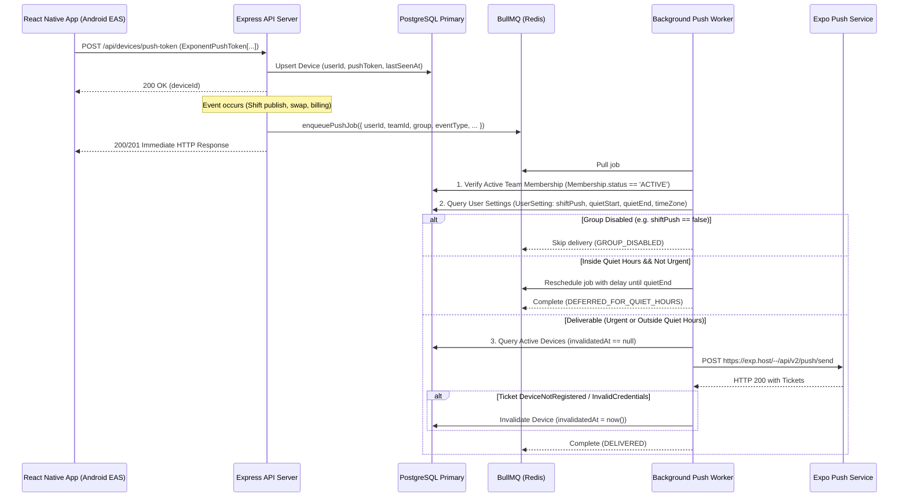

# Rota Push Notification Architecture & Delivery Specification

## 1. Overview & PRD Alignment

Rota provides reliable, Android-first push notifications for shift workers, managers, and team owners across shifts, swaps, and billing updates (PRD F7.1–F7.5, Section 7). Notification delivery is decoupled from HTTP request cycles via a durable Redis-backed BullMQ job queue and enforces strict user preferences, quiet hours, and authorization guards at execution time.

---

## 2. Architecture & Data Flow



---

## 3. Device Registration & Token Lifecycle (PRD F7.1)

### 3.1 Multiple Device Support
- Users can log in and register push tokens across multiple Android devices or tablets.
- Each device registration creates or updates a record in the PostgreSQL `Device` table:
  - `userId`: Bound to the authenticated user account.
  - `pushToken`: Unique Expo Push Token string (`ExponentPushToken[...]`).
  - `lastSeenAt`: Timestamp of the most recent registration/sync.
  - `invalidatedAt`: Nullable timestamp indicating revocation.

### 3.2 Token Rotation
- When an Expo Push Token rotates on an existing device (e.g., app re-install or token refresh), the client sends:
  ```json
  POST /api/devices/push-token
  {
    "pushToken": "ExponentPushToken[new-token]",
    "oldPushToken": "ExponentPushToken[old-token]"
  }
  ```
- The backend invalidates `oldPushToken` by setting `invalidatedAt = new Date()`, registers `newPushToken`, and leaves tokens from the user's other devices intact.

### 3.3 De-registration and Invalidation
- **User Logout:** `DELETE /api/devices/push-token` or `POST /api/auth/logout` with `pushToken` invalidates the specific device token immediately.
- **All-Device Logout:** `POST /api/auth/logout-all` invalidates all push tokens and sessions for the user.
- **Provider Cleanup:** When Expo Push Service returns tickets with error code `DeviceNotRegistered` or `InvalidCredentials`, the worker marks `invalidatedAt = new Date()` on that specific device without touching other devices.
- **Transient Failures:** HTTP 500 or network gateway failures throw an error inside the worker, triggering BullMQ exponential retries (3 attempts, backoff delay 1500ms) without invalidating valid tokens.

---

## 4. Send-Time Preference & Quiet-Hours Rules (PRD F7.4, F7.5, AGENTS.md Rule 18)

Push delivery decisions are evaluated strictly at **send time** against fresh PostgreSQL state:

### 4.1 Notification Groups
Three independent groups exist:
1. `SHIFT`: New shifts, published schedule updates, shift cancellations.
2. `SWAP`: Colleague swap requests, manager approval/rejection outcomes.
3. `BILLING`: Payment reminders, renewal alerts, overdue invoice notices.

> [!IMPORTANT]
> **AGENTS.md Rule 18 Invariant:** A disabled group always wins. If `shiftPush: false`, shift notifications are suppressed permanently, even if the shift starts within 12 hours.

### 4.2 Quiet Hours Boundary Convention
- Expressed in user's local `timeZone` (e.g. `quietStart: "22:00"`, `quietEnd: "06:00"`).
- **Boundary Convention:** Start-inclusive, end-exclusive `[quietStart, quietEnd)`.
  - At exactly `22:00:00`, quiet hours apply (notifications are deferred).
  - At exactly `06:00:00`, quiet hours end (notifications are delivered).
- Spans midnight cleanly (e.g. 22:00 to 06:00 or 23:00 to 07:00).
- When a non-urgent notification arrives during quiet hours, BullMQ calculates `delayMs` until `quietEnd` in the recipient's timezone and reschedules a delayed job (`DEFERRED_FOR_QUIET_HOURS`).

### 4.3 Urgency Classification
Only specific event types qualify for quiet-hours bypass, and **strictly** when the shift starts within 12 hours in the future:
- **Urgent Event Types:**
  - `SHIFT_CHANGE`
  - `SHIFT_CANCEL`
  - `SWAP_APPROVAL`
  - `SWAP_REJECTION`
- **Future Window Rule:** `timeToShift > 0 && timeToShift <= 12 * 60 * 60 * 1000`. Past shifts (`<= 0`) or shifts starting more than 12 hours away **never** qualify as urgent.
- **Non-Urgent Event Types:**
  - `NEW_SHIFT`: Always deferred during quiet hours.
  - `SWAP_REQUEST`: Always deferred during quiet hours.
  - `BILLING`: Always deferred during quiet hours.

---

## 5. Pre-Send Membership & Access Revocation

Delayed or queued jobs re-verify the recipient's active team membership before dispatch:
- If `teamId` is present on the push job, the worker queries `Membership` where `userId = recipientId`, `teamId = teamId`, and `status = 'ACTIVE'`.
- If the user was removed from the team or deactivated while the job was waiting in the queue, the worker immediately suppresses delivery (`SKIPPED`, `reason: 'ACCESS_REVOKED'`). Confidential team shift data is never leaked to former members.

---

## 6. Remote Push Evidence & Environment Constraints

- **Local / Automated Verification:** Unit and integration test suites simulate Expo push dispatch with mock responses for tickets, failures, and device invalidations.
- **Android EAS Development Build:** Real remote push notifications on Android require an EAS development build (`expo run:android` or EAS build apk) with the Google Services configuration. Remote push cannot be demonstrated solely via Expo Go.
